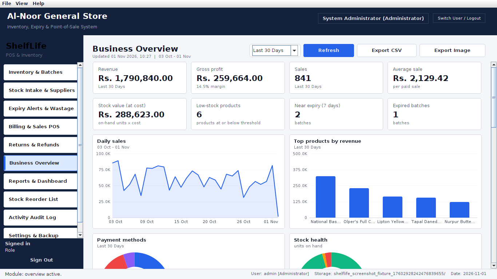
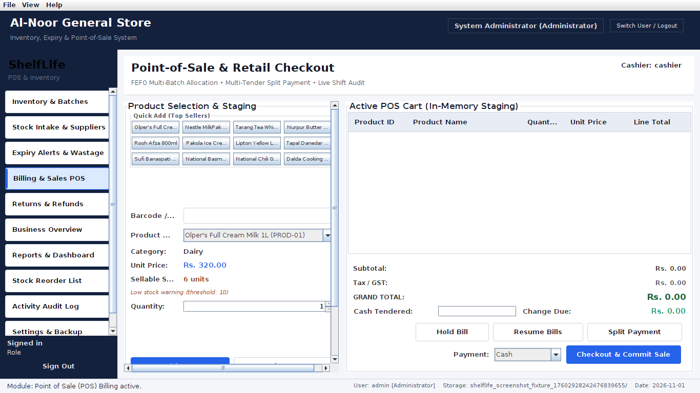
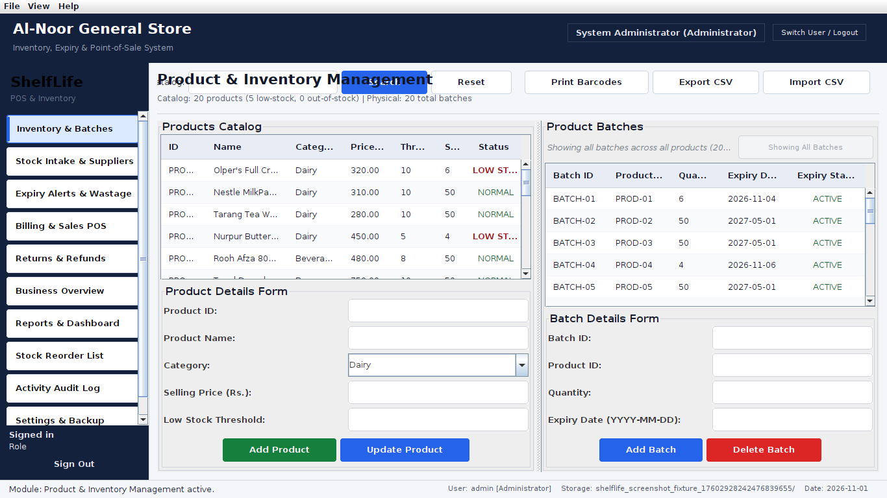
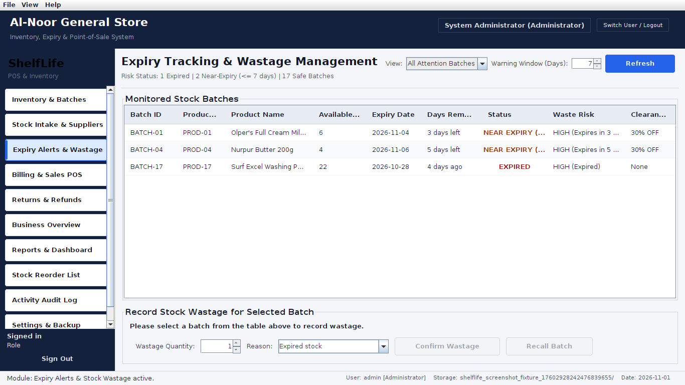
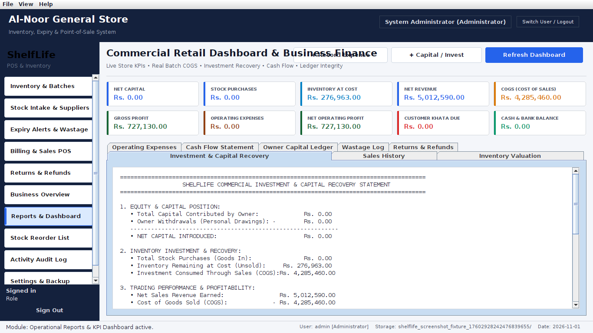

# ShelfLife


**Inventory, expiry and billing for small shops that sell food and other perishable goods.**

ShelfLife is a desktop app for a shop owner and their cashiers. It answers the questions a shopkeeper actually has: *What is about to expire? What should I reorder? How much did I really earn this month? Who owes me money?* Everything runs on one computer, needs no internet and no database server, and the data is stored in plain CSV files you can open in Excel.

It started as a university Object-Oriented Programming project (a five-member team) and was then turned into a complete working application. Prices are in Pakistani rupees (PKR) and the payment methods include Easypaisa and JazzCash.



## What it can do

**Selling**
- Point-of-sale screen with barcode, SKU and name search
- Pay with cash, card, Easypaisa, JazzCash or store credit, or split one bill over several methods
- Hold a bill while you serve another customer, then resume it
- Warning when you are about to sell below cost
- Customer credit book (Khata) with credit limits and a running balance
- Receipts you can print, copy or save
- Returns and refunds: put the item back on the shelf or write it off as waste
- Cashier shifts: opening float, cash sales, and a counted-cash check when the shift closes

**Stock and expiry**
- Every delivery is a *batch* with its own expiry date and cost price
- Sales always take the batch that expires first (FEFO), and expired or recalled stock can never be sold
- Expiry alerts, wastage records and a reorder list
- Import products from a CSV file (with a preview and a list of errors before anything is saved), export to CSV, print barcode labels
- Suppliers, purchases with transport cost added to the unit cost, and what you still owe each supplier

**Money and reports**
- **Business Overview** dashboard: revenue, gross profit and margin, stock value, daily sales trend, best sellers, payment mix, stock health, wastage, monthly profit, busiest hours, and tables for what is expiring, low on stock or not selling. Export to CSV or PNG.
- Profit report that also accounts for wastage and refunds
- Owner capital, expenses and cash/bank accounts, so investment is never mixed up with sales

**Safety**
- Administrator and cashier roles; cashiers only see Billing, Returns and the product catalogue
- Passwords are stored with salted PBKDF2; the first sign-in of the default accounts forces a new password
- Activity log of important actions, backup and restore, and all-or-nothing writes (a failed save never leaves half-written data)

## Screenshots

| Billing | Inventory and batches |
| --- | --- |
|  |  |

| Expiry alerts | Reports |
| --- | --- |
|  |  |

More are in [docs/screenshots](docs/screenshots).

## Getting started

You need a **JDK 8 or newer** (the full JDK, not only the runtime, because the build uses `javac`). Check with `javac -version`.

**Windows**
```
compile.bat
run.bat
```

**Linux / macOS**
```
./compile.sh
./run.sh
```

On the first start the app creates its data folder at `~/ShelfLifeData` and a small starter catalogue of 20 grocery products. Sign in with:

| Role | Username | Password |
| --- | --- | --- |
| Administrator | `admin` | `admin123` |
| Cashier | `cashier` | `cashier123` |

These passwords only work once: the app makes you choose a new one right after the first sign-in.

### Try it with three months of demo sales

This uses a separate folder, so your real data is never touched.

```
java -cp build/classes:build/test/classes shelflife.test.DemoShop demo-home/ShelfLifeData
java -Duser.home=demo-home -cp build/classes shelflife.ui.ShelfLifeApp
```

On Windows replace `:` with `;` in the first command.

## Tests

```
test.bat        (Windows)
./test.sh       (Linux / macOS)
```

The suite has 44 scenarios, including FEFO allocation, rejected sales, rollbacks of interrupted writes, returns, credit and supplier payments, profit calculations, password hashing and upgrade, the dashboard numbers, and a check that the [data dictionary](docs/DATA_DICTIONARY.md) matches the files the program really writes. It opens real Swing windows, so on a server without a screen run it with `xvfb-run`. GitHub Actions runs it on Java 8 and Java 17 for every push.

## How it is built

Plain Java 8 and Swing, no external libraries. The code has three layers: screens (`ui`), business rules (`service`) and storage (`storage`), connected through interfaces. The full picture with diagrams is in [docs/ARCHITECTURE.md](docs/ARCHITECTURE.md).

```
src/shelflife/
  model/     data classes (Product, ProductBatch, Sale, User, ...)
  service/   business rules, one interface + implementation per area
  storage/   DataStore interface and the CSV implementation
  ui/        Swing windows; ui/chart has the line, bar and donut charts
  util/      password hashing, currency, CSV export, barcode labels
test/        test suite, demo-data generator, screenshot tool
docs/        architecture, data dictionary, screenshots
```

Why CSV files? A small shop does not want to install and look after a database server, and a plain file can be opened, checked and backed up by anyone. The price is that it fits one shop and one computer, which is the use case this project is built for.

## Known limits

- One computer, one running copy of the app at a time. It is not designed for several tills writing at once.
- Receipts print through the normal system print dialog. A narrow 80 mm thermal layout (`ThermalReceiptRenderer`) is written but not connected to the screens yet.
- Logging of manual price overrides exists in the service layer but the till screen does not use it yet.
- The tests use a small custom runner instead of JUnit.
- No installer yet. `ant jar` builds `dist/ShelfLife.jar` if you have Apache Ant.
- No licence has been chosen yet.

## The team

Built as a five-member university project. The original work of each member is still in the repository history (see the `before-cleanup` tag and `git shortlog -sn`).
