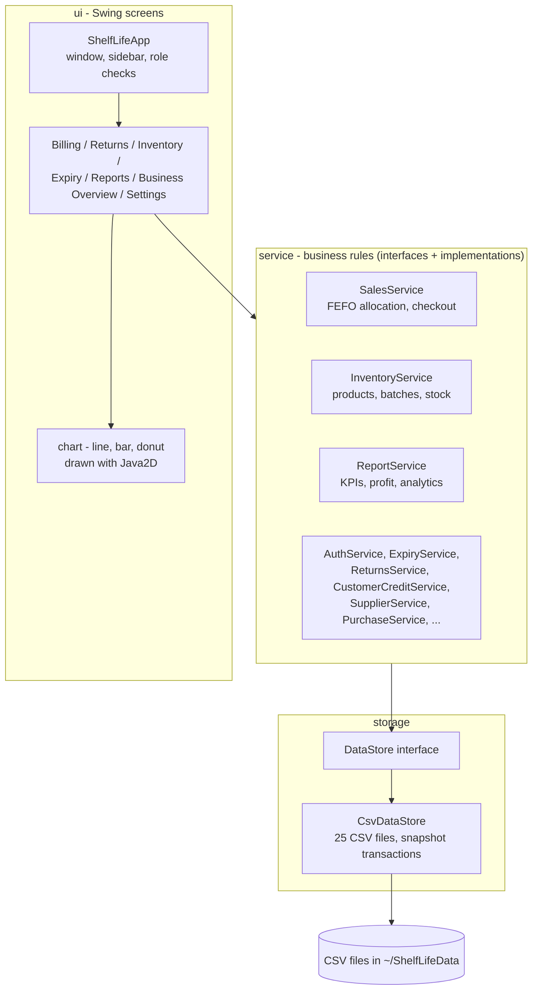
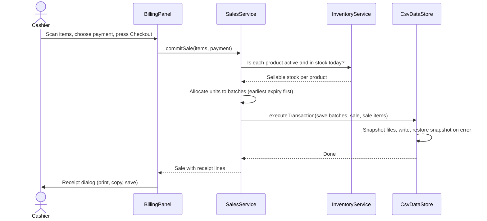
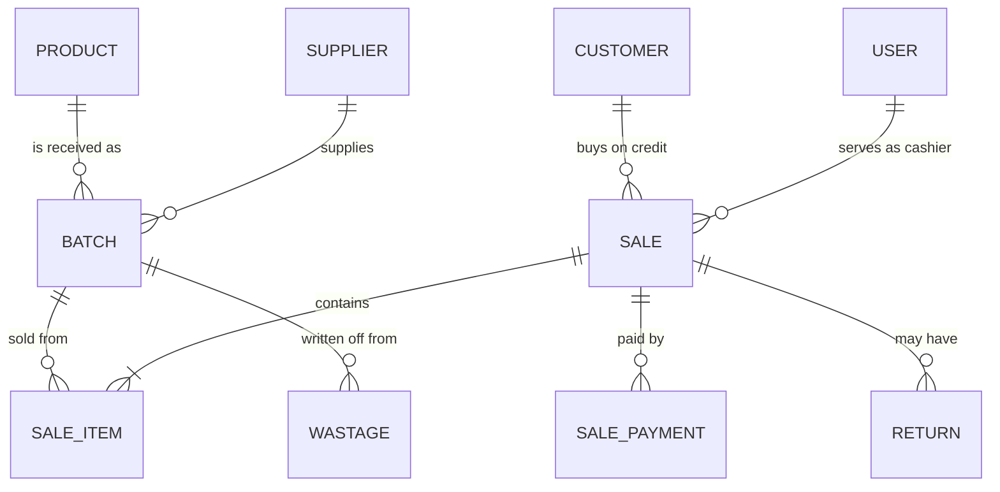

# Architecture

ShelfLife is a desktop application written in plain Java 8 with Swing. It has no external libraries and no database server. The code is split into layers so that screens never touch files directly and business rules never depend on the user interface.

## Packages

| Package | What lives there |
| --- | --- |
| `shelflife.model` | Plain data classes (`Product`, `ProductBatch`, `Sale`, `SaleItem`, `User`, ...). No logic about screens or files. |
| `shelflife.service` | One interface per business area, each with an `...Impl`. All rules live here: stock allocation, returns, credit limits, profit, permissions. |
| `shelflife.storage` | `DataStore` (what the app needs from storage) and `CsvDataStore` (how it is done with CSV files). |
| `shelflife.ui` | Swing windows and panels. They call services and show the result; they do not read or write files. |
| `shelflife.ui.chart` | Small chart components (`LineChartPanel`, `BarChartPanel`, `DonutChartPanel`) that share one base class. |
| `shelflife.util` | Helpers: password hashing, currency formatting, CSV export, barcode label printing, first-run demo catalogue. |

## Design decisions

- **Interfaces between layers.** Screens depend on `SalesService`, not on `SalesServiceImpl`; services depend on `DataStore`, not on CSV. Replacing CSV with a real database would only mean writing another `DataStore`.
- **Stock is derived, never typed in.** A product has no stock number. Its stock is the sum of its batches, so stock can always be explained from received lots, sales, returns and wastage.
- **FEFO (first expired, first out).** When a sale is made, units are taken from the batch that expires first, and expired or recalled batches are never sold. The cost of the batch is stored on the sale line, so profit is exact even when prices change.
- **All-or-nothing writes.** A sale changes several files. `CsvDataStore.executeTransaction` copies every file to a `.bak` snapshot first and restores all of them if anything fails.
- **Roles.** `AccessControl` is the single place that answers "is this user an administrator?". Cashiers only see Billing, Returns and the product catalogue; the administrator sees everything.
- **Passwords.** Stored as salted PBKDF2 (HmacSHA256, 120,000 iterations). Older accounts with a plain SHA-256 hash are upgraded automatically the next time they sign in.
- **The UI never blocks.** The Business Overview loads its numbers in a background thread (`SwingWorker`) and applies them on the Swing thread.

## What happens when a sale is completed

## Main tables

The full list of all 25 tables and their columns is in [DATA_DICTIONARY.md](DATA_DICTIONARY.md). A test checks that this list matches what the program really writes.

