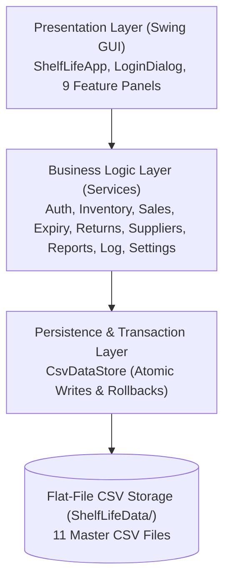
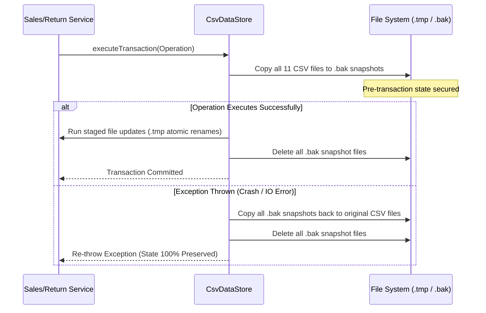

# ShelfLife System Architecture & Interface Contract (`CONTRACT.md`)

## 1. System Overview & Architectural Baseline

**ShelfLife** is an offline, multi-tier Java Desktop Point-of-Sale (POS) and Inventory Management System designed for grocery stores, supermarkets, and pharmacies. The system enforces strict First-Expiry-First-Out (FEFO) stock rotation, batch-level tracking, customer returns, audit logging, and role-based access control (RBAC).

### Technology Stack & Constraints
- **Language**: Java 8 SE syntax compatibility (executing on OpenJDK 21 LTS).
- **GUI Framework**: Java Swing (`javax.swing`) with Nimbus Look-and-Feel and cross-platform fallbacks.
- **Persistence**: 100% offline flat-file CSV storage with RFC-4180 parsing, multi-file atomic transactions, and rollback snapshot engines.
- **Financial Math**: `java.math.BigDecimal` with `RoundingMode.HALF_UP` (Scale = 2) and uniform Pakistani Rupee formatting (`Rs. #,##0.00`).
- **External Dependencies**: Zero third-party runtime JARs or external database servers.

---

## 2. Layered Architecture

ShelfLife adheres strictly to Separation of Concerns (SoC) across three distinct layers:

1. **Presentation Layer (`shelflife.ui.*`)**:
   - `ShelfLifeApp`: Main application frame hosting the role-based navigation sidebar, top branded header, status bar, and central `CardLayout` container.
   - `LoginDialog`: Modal authentication window with role routing.
   - 9 Feature Panels:
     - [`ProductInventoryPanel`](file:///e:/Uni%20Learning/JAVA/2nd%20Sem/Shelf%20Life%20%28Inventory%20Management%20System%29/ShelfLife/src/shelflife/ui/inventory/ProductInventoryPanel.java)
     - [`SuppliersPanel`](file:///e:/Uni%20Learning/JAVA/2nd%20Sem/Shelf%20Life%20%28Inventory%20Management%20System%29/ShelfLife/src/shelflife/ui/inventory/SuppliersPanel.java)
     - [`ExpiryAlertsPanel`](file:///e:/Uni%20Learning/JAVA/2nd%20Sem/Shelf%20Life%20%28Inventory%20Management%20System%29/ShelfLife/src/shelflife/ui/expiry/ExpiryAlertsPanel.java)
     - [`BillingPanel`](file:///e:/Uni%20Learning/JAVA/2nd%20Sem/Shelf%20Life%20%28Inventory%20Management%20System%29/ShelfLife/src/shelflife/ui/billing/BillingPanel.java)
     - [`ReturnsPanel`](file:///e:/Uni%20Learning/JAVA/2nd%20Sem/Shelf%20Life%20%28Inventory%20Management%20System%29/ShelfLife/src/shelflife/ui/billing/ReturnsPanel.java)
     - [`DashboardReportsPanel`](file:///e:/Uni%20Learning/JAVA/2nd%20Sem/Shelf%20Life%20%28Inventory%20Management%20System%29/ShelfLife/src/shelflife/ui/reports/DashboardReportsPanel.java)
     - [`ReorderListPanel`](file:///e:/Uni%20Learning/JAVA/2nd%20Sem/Shelf%20Life%20%28Inventory%20Management%20System%29/ShelfLife/src/shelflife/ui/reports/ReorderListPanel.java)
     - [`ActivityLogPanel`](file:///e:/Uni%20Learning/JAVA/2nd%20Sem/Shelf%20Life%20%28Inventory%20Management%20System%29/ShelfLife/src/shelflife/ui/reports/ActivityLogPanel.java)
     - [`SettingsAndBackupPanel`](file:///e:/Uni%20Learning/JAVA/2nd%20Sem/Shelf%20Life%20%28Inventory%20Management%20System%29/ShelfLife/src/shelflife/ui/SettingsAndBackupPanel.java)

2. **Service Layer (`shelflife.service.*`)**:
   - Encapsulates all domain validations, transaction workflows, FEFO batch allocations, and mathematical calculations.
   - Interfaces decouple implementation from consumption.

3. **Storage & Data Access Layer (`shelflife.storage.*`)**:
   - [`DataStore`](file:///e:/Uni%20Learning/JAVA/2nd%20Sem/Shelf%20Life%20%28Inventory%20Management%20System%29/ShelfLife/src/shelflife/storage/DataStore.java): Central persistence contract.
   - [`CsvDataStore`](file:///e:/Uni%20Learning/JAVA/2nd%20Sem/Shelf%20Life%20%28Inventory%20Management%20System%29/ShelfLife/src/shelflife/storage/CsvDataStore.java): Thread-safe file IO implementation with atomic file swaps (`.tmp`) and multi-file snapshot rollback recovery (`.bak`).

---

## 3. Core Domain Entities & Data Models

| Entity Model | Primary Key | Key Invariants | Storage File |
| :--- | :--- | :--- | :--- |
| [`Product`](file:///e:/Uni%20Learning/JAVA/2nd%20Sem/Shelf%20Life%20%28Inventory%20Management%20System%29/ShelfLife/src/shelflife/model/Product.java) | `productId` | Upper-case ID; selling price > 0; threshold >= 0; barcode/SKU unique indexable. | `products.csv` |
| [`ProductBatch`](file:///e:/Uni%20Learning/JAVA/2nd%20Sem/Shelf%20Life%20%28Inventory%20Management%20System%29/ShelfLife/src/shelflife/model/ProductBatch.java) | `batchId` | References valid `productId`; quantity >= 0; costPrice >= 0; sorted by `expiryDate` asc. | `batches.csv` |
| [`Sale`](file:///e:/Uni%20Learning/JAVA/2nd%20Sem/Shelf%20Life%20%28Inventory%20Management%20System%29/ShelfLife/src/shelflife/model/Sale.java) | `saleId` | Total strictly equals sum of child `SaleItem.lineTotal`; non-empty item list. | `sales.csv` |
| [`SaleItem`](file:///e:/Uni%20Learning/JAVA/2nd%20Sem/Shelf%20Life%20%28Inventory%20Management%20System%29/ShelfLife/src/shelflife/model/SaleItem.java) | `saleItemId` | References valid `saleId`, `productId`, `batchId`; quantity > 0; unitPrice > 0. | `sale_items.csv` |
| [`SaleReturn`](file:///e:/Uni%20Learning/JAVA/2nd%20Sem/Shelf%20Life%20%28Inventory%20Management%20System%29/ShelfLife/src/shelflife/model/SaleReturn.java) | `returnId` | References existing `originalSaleId`; totalRefund equals sum of line refunds. | `returns.csv` |
| [`SaleReturnItem`](file:///e:/Uni%20Learning/JAVA/2nd%20Sem/Shelf%20Life%20%28Inventory%20Management%20System%29/ShelfLife/src/shelflife/model/SaleReturnItem.java) | `returnItemId` | `returnQty + priorReturns <= originalSoldQty`; disposition in (`RESTOCK`, `WASTAGE`). | `return_items.csv` |
| [`Supplier`](file:///e:/Uni%20Learning/JAVA/2nd%20Sem/Shelf%20Life%20%28Inventory%20Management%20System%29/ShelfLife/src/shelflife/model/Supplier.java) | `supplierId` | Unique uppercase ID; mandatory supplier name. | `suppliers.csv` |
| [`User`](file:///e:/Uni%20Learning/JAVA/2nd%20Sem/Shelf%20Life%20%28Inventory%20Management%20System%29/ShelfLife/src/shelflife/model/User.java) | `userId` | Unique lower-case username; salted SHA-256 hash; role in (`ADMIN`, `CASHIER`). | `users.csv` |
| [`WastageRecord`](file:///e:/Uni%20Learning/JAVA/2nd%20Sem/Shelf%20Life%20%28Inventory%20Management%20System%29/ShelfLife/src/shelflife/model/WastageRecord.java) | `wastageId` | References valid `batchId`; quantity > 0; non-empty reason. | `wastage.csv` |
| [`ActivityLogEntry`](file:///e:/Uni%20Learning/JAVA/2nd%20Sem/Shelf%20Life%20%28Inventory%20Management%20System%29/ShelfLife/src/shelflife/model/ActivityLogEntry.java) | `logId` | ISO-8601 timestamp, actor username, action verb, audit message. | `activity_logs.csv` |
| [`AppSettings`](file:///e:/Uni%20Learning/JAVA/2nd%20Sem/Shelf%20Life%20%28Inventory%20Management%20System%29/ShelfLife/src/shelflife/model/AppSettings.java) | N/A (Singleton) | Shop name, currency (`PKR`, `Rs.`), warning days (default 14), tax percent. | `settings.csv` |

---

## 4. Service Interfaces & Contract Specifications

### 4.1 AuthService
- `User login(String username, String password) throws Exception`: Authenticates against stored salt and SHA-256 hash. Returns `User` session entity. Rejects deactivated users.
- `void logout()`: Clears thread session.
- `void createUser(User user, String rawPassword) throws Exception`: Salts and hashes raw credentials, registers new account.
- `boolean changePassword(String username, String oldPassword, String newPassword) throws Exception`: Verifies old credentials, generates fresh salt, updates hash.

### 4.2 InventoryService
- `void addProduct(Product product) throws Exception`: Enforces uppercase unique `productId`, positive price, non-negative threshold.
- `void updateProduct(Product product) throws Exception`: Updates existing product attributes.
- `void deleteProduct(String productId) throws Exception`: Blocks hard deletion if active batches or historical sales exist; supports soft deactivation via `setProductActive(id, false)`.
- `List<Product> searchProducts(String query)`: Matches query against ID, Name, Category, Barcode, and SKU.
- `int getTotalStock(String productId)`: Returns sum of quantities across all batches.
- `int getSellableStock(String productId, LocalDate referenceDate)`: Returns sum of non-expired batches with `quantity > 0`.

### 4.3 SalesService
- `Sale commitSale(Map<String, Integer> productQuantities, PaymentMethod paymentMethod) throws SaleException`:
  - Enforces active product status.
  - Re-validates sellable stock on the spot.
  - Allocates batches strictly by First-Expiry-First-Out (`Comparator.naturalOrder()` on `expiryDate`).
  - Spans multi-batch deductions atomically.
  - Writes transaction to `sales.csv` and `sale_items.csv` within `executeTransaction`.
  - Emits auto-generated customer receipt text file into `receipts/` directory.

### 4.4 ReturnsService
- `SaleReturn processReturn(String saleId, List<SaleReturnItem> items, String reason, String processedBy) throws Exception`:
  - Looks up sale and hydrates original `SaleItem` records.
  - Enforces `quantity <= (soldQuantity - previouslyReturnedQuantity)`.
  - Computes exact refund in PKR.
  - If disposition is `RESTOCK`: increments batch quantity.
  - If disposition is `WASTAGE`: leaves sellable batch untouched and logs record to `wastage.csv`.
  - Persists return header and items atomically.

### 4.5 SupplierService
- `ProductBatch receiveStock(String productId, String batchId, int quantity, LocalDate expiryDate, BigDecimal costPrice, String supplierId) throws Exception`:
  - Registers batch intake with purchase cost and supplier linkage.

### 4.6 ReportService
- `BigDecimal getTotalRevenue()`: Sum of `PAID` sales.
- `BigDecimal getTotalProfit()`: Computes dynamic Net Operating Profit:
  $$\text{Net Profit} = \text{Revenue} - \text{COGS} - \text{Wastage} - \text{Refunds}$$
- `List<Product> getReorderList()`: Returns active products whose total stock $\le$ `lowStockThreshold`.

---

## 5. Persistence & Multi-File Transaction Contract

All storage mutations implement ACID-inspired guarantees over flat CSV files:

1. **Atomic File Writes**:
   - Files are written to `.tmp` files first via `OutputStreamWriter` with explicit `StandardCharsets.UTF_8`.
   - Flushed and closed cleanly before replacing the target file via atomic rename (`File.renameTo`).
2. **Crash & Power-Outage Resilience**:
   - `executeTransaction` creates synchronous `.bak` backup copies of all target files before executing operations.
   - If any step throws an unexpected runtime exception, all files are immediately restored from their `.bak` snapshots.
3. **Data Directory Resolution**:
   - Shared store directory defaults to `System.getProperty("user.home") + File.separator + "ShelfLifeData"`.
   - On initial bootstrap, sample CSV files from the local application `data/` folder are seeded automatically if the directory does not exist.
