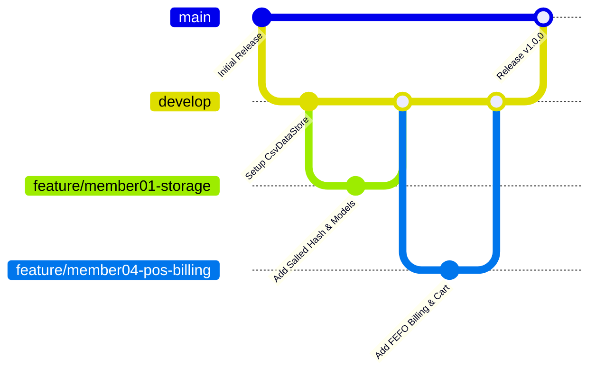

# Multi-Member Git Collaboration & Branching Guide (`GIT_GUIDE.md`)

This guide outlines the professional **Git Workflow** and version control standards for a 5-member university software engineering team collaborating on **ShelfLife**.

---

## 1. Branching Strategy & Architecture

We utilize a simplified **GitFlow** branching strategy designed to prevent merge conflicts while maintaining a stable, production-ready `main` branch.



### Branch Topology
- **`main` (Production Branch)**: Always builds and passes all 30 regression tests. Never commit directly to `main`.
- **`develop` (Integration Branch)**: Active integration branch where features are merged and tested together before final release.
- **`feature/<member-name>-<module>` (Feature Branches)**: Individual developer branches branched off `develop`.

---

## 2. Member Branch Responsibilities

| Member | Feature Branch Name | Assigned Scope & Packages |
| :--- | :--- | :--- |
| **Member 01** | `feature/m01-core-storage` | Persistence (`shelflife.storage`), Core Models (`Product`, `ProductBatch`, `User`, `Role`), Security (`PasswordUtil`). |
| **Member 02** | `feature/m02-inventory` | Product Catalog (`shelflife.ui.inventory.ProductInventoryPanel`), Service (`InventoryService`). |
| **Member 03** | `feature/m03-expiry-wastage` | Batch Tracking & Expiry Alerts (`shelflife.ui.expiry.ExpiryAlertsPanel`), Service (`ExpiryService`). |
| **Member 04** | `feature/m04-pos-billing` | Point-of-Sale Billing (`shelflife.ui.billing.BillingPanel`), Returns (`ReturnsPanel`), Service (`SalesService`, `ReturnsService`). |
| **Member 05** | `feature/m05-reports-analytics` | KPI Dashboard (`shelflife.ui.reports.DashboardReportsPanel`), Reorder Planning, Service (`ReportService`). |

---

## 3. Daily Team Git Workflow

### Step 1: Starting Your Day (Sync with Develop)
Before writing any code, always pull the latest shared changes:
```bash
git checkout develop
git pull origin develop
git checkout feature/m04-pos-billing
git merge develop
```

### Step 2: Committing Your Work
Write clean, atomic commits adhering to the Conventional Commits specification:
```bash
git add src/shelflife/service/SalesServiceImpl.java
git commit -m "feat(billing): implement multi-batch FEFO stock allocation"
```

### Step 3: Pushing and Creating a Pull Request (PR)
```bash
git push -u origin feature/m04-pos-billing
```
1. Open a Pull Request on GitHub/GitLab targeting `develop`.
2. Ensure at least one peer team member reviews the code.
3. Verify that `compile.bat` and `test.bat` run with 100% pass rate before merging.

---

## 4. Conflict Resolution Protocol

Merge conflicts typically occur when two members edit shared files (such as `ShelfLifeApp.java` or `CsvDataStore.java`).

### Conflict Resolution Steps:
1. Ensure your local branch is checked out:
   ```bash
   git checkout feature/my-feature
   ```
2. Pull and merge `develop` into your feature branch locally:
   ```bash
   git merge develop
   ```
3. Open the conflicted files in VS Code, IntelliJ, or NetBeans.
4. Locate Git conflict markers:
   ```java
   <<<<<<< HEAD (Your local changes)
       cardPanel.add(billingPanel, "billing");
   =======
       cardPanel.add(returnsPanel, "returns");
   >>>>>>> develop (Incoming changes from peer)
   ```
5. Resolve the conflict by combining both valid additions:
   ```java
       cardPanel.add(billingPanel, "billing");
       cardPanel.add(returnsPanel, "returns");
   ```
6. Save the file, verify compilation with `compile.bat`, and complete the merge:
   ```bash
   git add src/shelflife/ui/ShelfLifeApp.java
   git commit -m "merge: resolve sidebar navigation conflict with develop"
   git push origin feature/my-feature
   ```

---

## 5. Commit Message Convention

Format: `<type>(<scope>): <subject>`

- `feat`: A new user-facing feature or service capability.
  - *Example*: `feat(returns): add dual disposition for restock vs wastage write-off`
- `fix`: A bug fix or defect remediation.
  - *Example*: `fix(security): salt passwords before hashing with SHA-256`
- `docs`: Documentation updates only.
  - *Example*: `docs(manual): add cashier POS walkthrough guide`
- `test`: Adding or expanding test cases.
  - *Example*: `test(audit): add scenario 27 backup and restore regression test`
- `refactor`: Code changes that neither fix a bug nor add a feature.
  - *Example*: `refactor(math): replace floating point double with BigDecimal in PKR`
