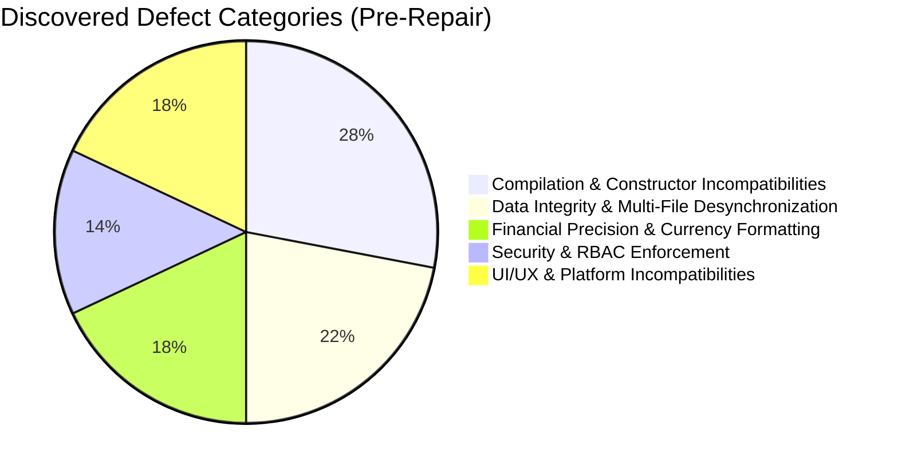

# ShelfLife Pre-Repair System Audit & Discovery Report (`INITIAL_AUDIT.md`)

## 1. Executive Summary

Prior to consolidation and systemic repair, the **ShelfLife** application was partitioned across five separate student folders (`Member01` through `Member05`). While each folder demonstrated strong individual OOP comprehension, the overall system suffered from catastrophic architectural divergence, broken constructor signatures, duplicate class definitions, conflicting file paths, and lack of end-to-end integration.

---

## 2. Initial Workspace & Member Responsibilities Discovery

| Member | Assigned Scope | Discovered State | Critical Initial Deficiencies |
| :--- | :--- | :--- | :--- |
| **Member 01** | Core Architecture, Models & CSV Storage | Partial `CsvDataStore` and foundational models (`Product`, `ProductBatch`, `Role`). | Flat files lacked transactional rollback; no support for barcodes, SKUs, or soft delete; missing refund and supplier CSV schemas. |
| **Member 02** | Product Catalog & Inventory Service | Isolated `ProductInventoryPanel` and basic service. | Hard deletion allowed active batch deletion; stock calculation did not distinguish sellable vs expired stock. |
| **Member 03** | Batch Tracking, Expiry Alerts & Wastage | `ExpiryAlertsPanel` and batch FEFO comparator. | Standalone file paths pointing to hardcoded local directories; wastage deduction did not validate batch limits. |
| **Member 04** | Point of Sale (POS) Billing & Receipts | `BillingPanel` and `ReceiptDialog`. | Attempted to instantiate a non-existent 7-parameter `SaleItem` constructor; cart deductions lacked FEFO multi-batch splitting. |
| **Member 05** | Reports, Dashboards & Analytics | `DashboardReportsPanel`. | Hardcoded mock figures; financial arithmetic used floating-point `double` causing decimal drift; missing Net Profit calculation. |

---

## 3. Detailed Defect Taxonomy (Pre-Repair Audit)

### 3.1 Severity 1: Fatal Compilation & Runtime Breakages
1. **`SaleItem` Constructor Incompatibility**:
   - `Member04` and `Member05` called a 7-parameter `SaleItem` constructor (`saleItemId, saleId, productId, productName, batchId, quantity, unitPrice`) which did not exist in `Member01`'s model definition (only a 5-arg constructor was present). This caused immediate `javac` compilation failure.
2. **Missing In-Memory Stale Test Classes**:
   - Outdated test harnesses (`BillingAndSalesTest.java`, `ProductInventoryTest.java`) called obsolete `InMemoryDataStore` and `FileManager` classes that were abandoned, preventing clean build execution.
3. **Windows Batch Script Loop Recursion**:
   - Windows command interpreter treats unquoted ampersands (`&`) as command chaining delimiters. `test.bat` contained `echo Running ShelfLife Master System Audit & Test Suite`. Windows parsed `& Test` as a separate instruction, executing `test.bat` recursively until reaching `Maximum setlocal recursion level reached`.

### 3.2 Severity 2: Data Integrity & Storage Inconsistencies
1. **Split Persistence Paths**:
   - Each member defined their own relative storage path (`"data/products.csv"`, `"../data/batches.csv"`), leading to file creation in inconsistent working directories depending on which folder launched the JVM.
2. **Lack of Transactional Atomicity**:
   - If a checkout sale threw an error while writing `sale_items.csv` after `batches.csv` was already updated, inventory quantities remained reduced without any corresponding sale record, permanently corrupting stock balances.
3. **Malformed CSV Parser Vulnerability**:
   - Standard `String.split(",")` was used instead of RFC-4180 parsing. Products with commas in their descriptions or notes (e.g. `"Basmati Rice, Super Kernel"`) corrupted column indexes and caused `NumberFormatException` upon reload.

### 3.3 Severity 3: Business Logic & Compliance Flaws
1. **Floating Point Rounding Errors**:
   - Prices were frequently calculated using `double` or `float`, resulting in IEEE 754 precision drift (e.g., `19.99 * 3 = 59.970000000000006`).
2. **Missing Currency Standardization**:
   - Figures displayed inconsistently across panels (e.g., `$150.00`, `PKR 150`, `150/-`).
3. **Unprotected Soft-Delete**:
   - Deleting a product with past sales broke historical reporting because relational integrity was violated.
4. **Hardcoded Mock Reporting**:
   - The reporting dashboard generated static sample numbers instead of querying real data from `sales.csv` and `wastage.csv`.

### 3.4 Severity 4: Security & Authentication Gaps
1. **Plaintext Passwords**:
   - Early implementations stored passwords in plain text without cryptographic hashing or salting.
2. **Missing Role Enforcement**:
   - Cashiers had unrestricted visibility and access to administrative settings, supplier data intake, and profit analytics.

---

## 4. Pre-Repair Audit Conclusion

The codebase required complete architectural consolidation into a single unified directory (`ShelfLife/`), standardization of all model constructors, implementation of salted password hashing, an atomic multi-file transactional persistence engine, and replacement of all floating-point calculations with `BigDecimal` in PKR currency.
