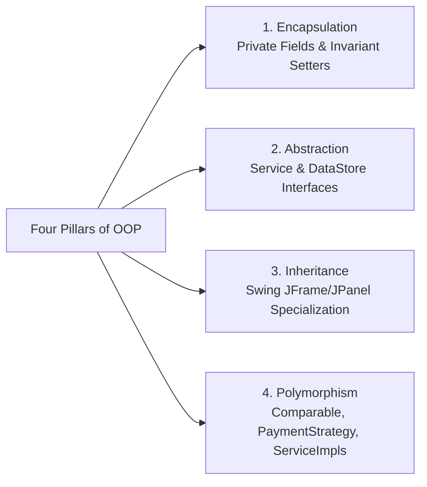

# University Viva Guide: Object-Oriented Programming (OOP) in ShelfLife (`OOP_CONCEPTS.md`)

This guide provides an academic examination of how core **Object-Oriented Programming (OOP) Principles** and **SOLID Design Principles** are implemented in the **ShelfLife** codebase. Use this document during project viva examinations to demonstrate software engineering mastery.

---

## 1. The Four Pillars of OOP in ShelfLife



### 1.1 Encapsulation
**Definition**: Bundling data with the methods that operate on that data and restricting direct access to object internals to protect state invariants.

**Code Examples in ShelfLife**:
- [`Product.java`](file:///e:/Uni%20Learning/JAVA/2nd%20Sem/Shelf%20Life%20%28Inventory%20Management%20System%29/ShelfLife/src/shelflife/model/Product.java): All fields (`productId`, `name`, `sellingPrice`, `lowStockThreshold`) are declared `private`. The setter methods actively validate business rules before modifying internal state:
  ```java
  public void setSellingPrice(BigDecimal sellingPrice) {
      if (sellingPrice == null || sellingPrice.compareTo(BigDecimal.ZERO) <= 0) {
          throw new IllegalArgumentException("Selling price must be strictly greater than zero.");
      }
      this.sellingPrice = sellingPrice.setScale(2, RoundingMode.HALF_UP);
  }
  ```
- [`ProductBatch.java`](file:///e:/Uni%20Learning/JAVA/2nd%20Sem/Shelf%20Life%20%28Inventory%20Management%20System%29/ShelfLife/src/shelflife/model/ProductBatch.java): Prevents negative stock corruption by throwing exceptions when deductions exceed available inventory:
  ```java
  public void deductQuantity(int amount) {
      if (amount <= 0) throw new IllegalArgumentException("Deduction quantity must be positive.");
      if (amount > this.quantity) throw new IllegalArgumentException("Cannot deduct more than available batch stock.");
      this.quantity -= amount;
  }
  ```

### 1.2 Abstraction
**Definition**: Hiding internal implementation complexities and exposing only high-level operational contracts to consumers.

**Code Examples in ShelfLife**:
- [`DataStore.java`](file:///e:/Uni%20Learning/JAVA/2nd%20Sem/Shelf%20Life%20%28Inventory%20Management%20System%29/ShelfLife/src/shelflife/storage/DataStore.java): Defines an abstract storage contract (`loadProducts()`, `saveBatches()`, `executeTransaction()`). The GUI layer is completely unaware of whether records are stored in CSV files, SQLite, or PostgreSQL.
- [`SalesService.java`](file:///e:/Uni%20Learning/JAVA/2nd%20Sem/Shelf%20Life%20%28Inventory%20Management%20System%29/ShelfLife/src/shelflife/service/SalesService.java): The billing UI calls `commitSale(productQuantities, paymentMethod)`. The complex underlying operations—validating sellable stock, sorting batches by FEFO, executing multi-batch deductions, creating transactional `.bak` snapshots, and formatting receipts—are completely abstracted away from the UI.

### 1.3 Inheritance
**Definition**: Reusing and extending existing class definitions to create specialized components without duplicating code.

**Code Examples in ShelfLife**:
- [`ShelfLifeApp.java`](file:///e:/Uni%20Learning/JAVA/2nd%20Sem/Shelf%20Life%20%28Inventory%20Management%20System%29/ShelfLife/src/shelflife/ui/ShelfLifeApp.java) extends `javax.swing.JFrame`: Inherits standard desktop window capabilities (resizing, closing, layout management) while specializing it with custom branded headers, sidebars, and status bars.
- UI Feature Panels ([`BillingPanel`](file:///e:/Uni%20Learning/JAVA/2nd%20Sem/Shelf%20Life%20%28Inventory%20Management%20System%29/ShelfLife/src/shelflife/ui/billing/BillingPanel.java), [`ReturnsPanel`](file:///e:/Uni%20Learning/JAVA/2nd%20Sem/Shelf%20Life%20%28Inventory%20Management%20System%29/ShelfLife/src/shelflife/ui/billing/ReturnsPanel.java), [`SuppliersPanel`](file:///e:/Uni%20Learning/JAVA/2nd%20Sem/Shelf%20Life%20%28Inventory%20Management%20System%29/ShelfLife/src/shelflife/ui/inventory/SuppliersPanel.java)) extend `javax.swing.JPanel`: Inherit container hierarchy while implementing specialized business panels.
- Custom Exception Hierarchy: [`SaleException.java`](file:///e:/Uni%20Learning/JAVA/2nd%20Sem/Shelf%20Life%20%28Inventory%20Management%20System%29/ShelfLife/src/shelflife/service/SaleException.java) extends `java.lang.Exception`, providing specific point-of-sale domain error reporting.

### 1.4 Polymorphism
**Definition**: The ability of different objects to respond to the same interface or method call in their own specialized way (Dynamic Method Dispatch).

**Code Examples in ShelfLife**:
- **Interface Implementation Polymorphism**:
  - `DataStore ds = new CsvDataStore(dir);`
  - Any method requiring `DataStore` can accept `CsvDataStore` (or future `SqlDataStore`) interchangeably at runtime.
- **`Comparable<ProductBatch>` for Natural Sorting**:
  - [`ProductBatch.java`](file:///e:/Uni%20Learning/JAVA/2nd%20Sem/Shelf%20Life%20%28Inventory%20Management%20System%29/ShelfLife/src/shelflife/model/ProductBatch.java) implements `Comparable<ProductBatch>`. When `Collections.sort(eligibleBatches)` is called, the JVM polymorphically invokes `compareTo()`, guaranteeing strict FEFO order:
  ```java
  @Override
  public int compareTo(ProductBatch o) {
      if (o == null) return -1;
      int cmp = this.expiryDate.compareTo(o.expiryDate);
      if (cmp != 0) return cmp;
      return this.batchId.compareToIgnoreCase(o.batchId);
  }
  ```
- **`Refreshable` Interface**:
  - Feature panels implement [`Refreshable.java`](file:///e:/Uni%20Learning/JAVA/2nd%20Sem/Shelf%20Life%20%28Inventory%20Management%20System%29/ShelfLife/src/shelflife/ui/Refreshable.java). When a user navigates between tabs, `ShelfLifeApp` polymorphically calls `refreshData()` regardless of which concrete panel is currently displayed.

---

## 2. SOLID Design Principles in ShelfLife

### 2.1 Single Responsibility Principle (SRP)
*Every class should have one, and only one, reason to change.*
- [`CsvDataStore.java`](file:///e:/Uni%20Learning/JAVA/2nd%20Sem/Shelf%20Life%20%28Inventory%20Management%20System%29/ShelfLife/src/shelflife/storage/CsvDataStore.java): Solely responsible for low-level CSV serialization, atomic file writes, and file rollbacks. It contains no sales tax logic or FEFO business logic.
- [`SalesServiceImpl.java`](file:///e:/Uni%20Learning/JAVA/2nd%20Sem/Shelf%20Life%20%28Inventory%20Management%20System%29/ShelfLife/src/shelflife/service/SalesServiceImpl.java): Solely responsible for checkout validation, batch allocation, and sales order creation.
- [`CurrencyUtil.java`](file:///e:/Uni%20Learning/JAVA/2nd%20Sem/Shelf%20Life%20%28Inventory%20Management%20System%29/ShelfLife/src/shelflife/util/CurrencyUtil.java): Solely responsible for formatting numeric values into Pakistani Rupee strings.

### 2.2 Open/Closed Principle (OCP)
*Software entities should be open for extension, but closed for modification.*
- **Payment Methods**: [`PaymentMethod.java`](file:///e:/Uni%20Learning/JAVA/2nd%20Sem/Shelf%20Life%20%28Inventory%20Management%20System%29/ShelfLife/src/shelflife/model/PaymentMethod.java) was cleanly extended with `EASYPAISA` and `JAZZCASH` without breaking existing `Sale` entities or historical CSV persistence records.
- **Storage Subsystem**: Adding a new database (e.g. MySQL) requires creating a class implementing `DataStore` without modifying any service or GUI classes.

### 2.3 Liskov Substitution Principle (LSP)
*Subtypes must be substitutable for their base types without altering program correctness.*
- Any class expecting `InventoryService` can safely use `InventoryServiceImpl` without unexpected side-effects.
- Custom exceptions ([`SaleException`](file:///e:/Uni%20Learning/JAVA/2nd%20Sem/Shelf%20Life%20%28Inventory%20Management%20System%29/ShelfLife/src/shelflife/service/SaleException.java)) can be caught as `java.lang.Exception` by standard error dialogs without breaking exception handling flows.

### 2.4 Interface Segregation Principle (ISP)
*Clients should not be forced to depend on interfaces they do not use.*
- Instead of a monolithic 100-method god interface, services are strictly segregated:
  - `AuthService` handles authentication only.
  - `SupplierService` handles vendor management and stock receiving only.
  - `ReturnsService` handles customer returns and refunds only.
  - `ActivityLogService` handles audit logging only.

### 2.5 Dependency Inversion Principle (DIP)
*High-level modules should not depend on low-level modules; both should depend on abstractions.*
- `ShelfLifeApp` and UI panels depend on service interfaces (`InventoryService`, `SalesService`, `ReturnsService`), not concrete implementation classes.
- Services depend on the persistence interface [`DataStore`](file:///e:/Uni%20Learning/JAVA/2nd%20Sem/Shelf%20Life%20%28Inventory%20Management%20System%29/ShelfLife/src/shelflife/storage/DataStore.java), not the concrete `CsvDataStore` class. This allows passing mock data stores during automated testing without affecting production code.

---

## 3. Key Design Patterns Utilized

1. **Model-View-Service / Layered Pattern**: Clean separation between Swing GUI, domain business rules, and disk storage.
2. **Strategy Pattern**: The `Comparable<ProductBatch>` implementation defines an interchangeable sorting strategy for FEFO stock allocation.
3. **Template / Command Pattern**: Transaction execution via functional interface `TransactionOperation` passed to `executeTransaction(() -> { ... })` encapsulates execution and rollback behavior.
4. **Singleton Configuration Pattern**: System preferences and shop metadata are centralized in [`AppSettings`](file:///e:/Uni%20Learning/JAVA/2nd%20Sem/Shelf%20Life%20%28Inventory%20Management%20System%29/ShelfLife/src/shelflife/model/AppSettings.java).
