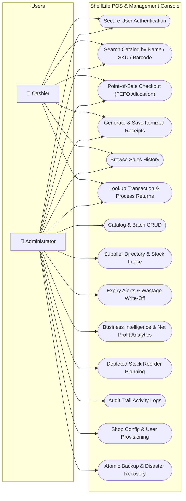
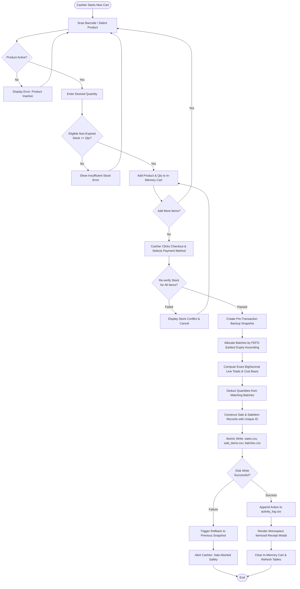
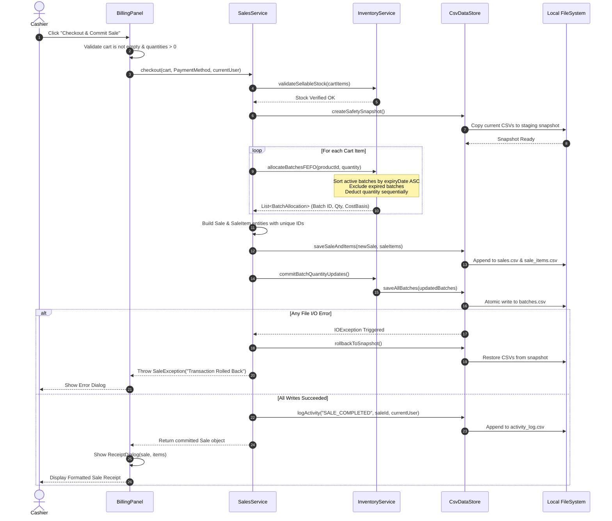
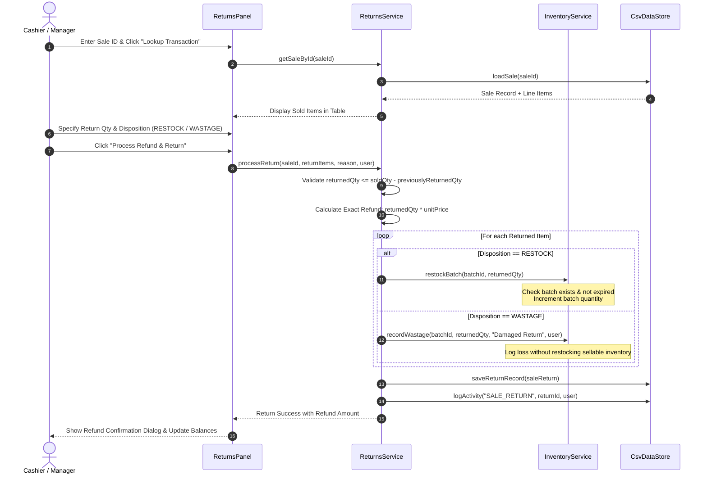

# ShelfLife — UML & System Architecture Design Document

**Project:** ShelfLife — Inventory, Expiry & Billing Management System  
**Framework:** Java Swing (Desktop, Offline)  
**Persistence:** Atomic Local CSV DataStore with Rollback & Crash Recovery  
**Target:** NetBeans Ant Project, University Java OOP Demonstration  

---

## 1. Class Diagram (Domain, Services, Storage & UI)

The following diagram illustrates the core Object-Oriented design of ShelfLife, emphasizing strong encapsulation, abstraction, and separation of concerns across Data, Service, and Presentation tiers.

```mermaid
classDiagram
    direction TB

    %% Storage & Persistence Layer
    class DataStore {
        <<interface>>
        +loadAllProducts() List~Product~
        +saveAllProducts(List~Product~) void
        +loadAllBatches() List~ProductBatch~
        +saveAllBatches(List~ProductBatch~) void
        +loadAllSales() List~Sale~
        +saveAllSales(List~Sale~) void
        +loadAllWastage() List~WastageRecord~
        +saveAllWastage(List~WastageRecord~) void
        +loadAllSuppliers() List~Supplier~
        +saveAllSuppliers(List~Supplier~) void
        +loadAllReturns() List~SaleReturn~
        +saveAllReturns(List~SaleReturn~) void
        +createBackup(File) BackupMetadata
        +restoreBackup(File) void
    }

    class CsvDataStore {
        -File dataDir
        -File lockFile
        -FileChannel lockChannel
        -FileLock fileLock
        +acquireDataLock() void
        +releaseDataLock() void
        -parseCsvLine(String) List~String~
        -formatCsvLine(List~String~) String
    }
    DataStore <|.. CsvDataStore

    %% Domain Models
    class Product {
        -String productId
        -String name
        -String category
        -BigDecimal price
        -int lowStockThreshold
        -boolean active
        -String barcode
        -String sku
        +getProductId() String
        +getName() String
        +getPrice() BigDecimal
        +isActive() boolean
        +validate() void
    }

    class ProductBatch {
        -String batchId
        -String productId
        -int quantity
        -LocalDate expiryDate
        -BigDecimal costPrice
        -String supplierId
        +getBatchId() String
        +getQuantity() int
        +setQuantity(int) void
        +getExpiryDate() LocalDate
        +isExpired(LocalDate) boolean
    }

    class Sale {
        -String saleId
        -LocalDateTime saleDateTime
        -BigDecimal totalAmount
        -PaymentMethod paymentMethod
        -String paymentStatus
        -List~SaleItem~ items
        +getSaleId() String
        +getTotalAmount() BigDecimal
        +getItems() List~SaleItem~
    }

    class SaleItem {
        -String saleItemId
        -String saleId
        -String productId
        -String productName
        -String batchId
        -int quantity
        -BigDecimal unitPrice
        -BigDecimal lineTotal
        -BigDecimal costPriceBasis
        +getLineTotal() BigDecimal
    }

    class SaleReturn {
        -String returnId
        -String originalSaleId
        -LocalDateTime returnDate
        -BigDecimal totalRefund
        -String processedBy
        -String reason
        -List~SaleReturnItem~ items
    }

    class WastageRecord {
        -String wastageId
        -String batchId
        -int quantity
        -LocalDateTime wastageDateTime
        -String reason
        -BigDecimal costLoss
    }

    class Supplier {
        -String supplierId
        -String name
        -String contactPerson
        -String phone
        -String email
        -String address
        -boolean active
    }

    Product "1" *-- "many" ProductBatch : batches
    Sale "1" *-- "many" SaleItem : items
    SaleReturn "1" *-- "many" SaleReturnItem : returnItems

    %% Service Tier
    class InventoryService {
        -DataStore dataStore
        +getAllProducts() List~Product~
        +addProduct(Product) void
        +updateProduct(Product) void
        +deleteProduct(String) void
        +getAllBatches() List~ProductBatch~
        +getBatchesForProduct(String) List~ProductBatch~
        +getTotalStock(String) int
        +getLowStockProducts() List~Product~
        +searchProducts(String) List~Product~
    }

    class SalesService {
        -DataStore dataStore
        -InventoryService inventoryService
        -ActivityLogService logService
        +checkout(Cart, PaymentMethod, User) Sale
        +allocateStockFEFO(String, int) List~ProductBatch~
        +getAllSales() List~Sale~
        +getSaleById(String) Sale
    }

    class ExpiryService {
        -DataStore dataStore
        -InventoryService inventoryService
        +getExpiredBatches(LocalDate) List~ProductBatch~
        +getNearExpiryBatches(LocalDate, int) List~ProductBatch~
        +recordWastage(String, int, String, User) WastageRecord
    }

    class ReturnsService {
        -DataStore dataStore
        -InventoryService inventoryService
        -SalesService salesService
        +processReturn(String, List~SaleReturnItem~, String, User) SaleReturn
    }

    class ReportService {
        -DataStore dataStore
        -InventoryService inventoryService
        +getTotalPhysicalStock() int
        +getSalesTotalForDate(LocalDate) BigDecimal
        +getTotalProfit() BigDecimal
        +getStockInformation() List~ProductBatch~
    }

    SalesService --> InventoryService
    SalesService --> DataStore
    InventoryService --> DataStore
    ExpiryService --> DataStore
    ReturnsService --> DataStore
    ReportService --> DataStore
```



---

## 2. Use-Case Diagram (Role-Based Access Control)

ShelfLife supports role-based access for two primary roles: **Administrator** and **Cashier**.



---

## 3. Activity Diagram: Point-of-Sale Billing & FEFO Allocation

The activity diagram depicts the full billing lifecycle, from product selection to atomic CSV commit.



---

## 4. Data-Flow Diagram (DFD Level 1)

This diagram details the movement of data between user interaction, in-memory services, and file storage.

```mermaid
flowchart TD
    subgraph External["External Actors"]
        CashierUser["Cashier / Manager"]
        AdminUser["System Administrator"]
    end

    subgraph Processes["System Services"]
        P1["1.0 Authentication & RBAC Service"]
        P2["2.0 Catalog & Batch Management"]
        P3["3.0 Point-of-Sale Billing (FEFO)"]
        P4["4.0 Returns & Wastage Service"]
        P5["5.0 Supplier & Purchase Intake"]
        P6["6.0 Reports & BI Analytics"]
        P7["7.0 Backup & Disaster Recovery"]
    end

    subgraph DataStore["Local Persistent CSV Storage"]
        D1[("users.csv")]
        D2[("products.csv")]
        D3[("batches.csv")]
        D4[("sales.csv & sale_items.csv")]
        D5[("wastage.csv")]
        D6[("returns.csv")]
        D7[("suppliers.csv")]
        D8[("settings.csv")]
        D9[("activity_log.csv")]
    end

    CashierUser -->|Credentials| P1
    P1 <-->|Verify Salted Hash| D1

    AdminUser -->|Product Details| P2
    P2 <-->|CRUD Records| D2
    P2 <-->|Batch Allocation| D3

    CashierUser -->|Cart & Checkout| P3
    P3 -->|Allocate FEFO| D3
    P3 -->|Persist Sale| D4
    P3 -->|Audit Event| D9

    CashierUser -->|Return Request| P4
    P4 <-->|Verify Original Sale| D4
    P4 -->|Restock or Wastage| D3
    P4 -->|Log Return| D6
    P4 -->|Log Loss| D5

    AdminUser -->|Intake New Stock| P5
    P5 <-->|Vendor Record| D7
    P5 -->|New Batch| D3

    AdminUser -->|Filter Criteria| P6
    P6 <--|Aggregate Data| D2
    P6 <--|Aggregate Data| D3
    P6 <--|Aggregate Data| D4
    P6 <--|Aggregate Data| D5
    P6 <--|Aggregate Data| D6

    AdminUser -->|Create / Restore| P7
    P7 <-->|Full Data Mirror| DataStore
```

---

## 5. Sequence Diagram: Sale Transaction Checkout (FEFO)

Detailed sequence illustrating the transactional boundary and inter-service messaging during a checkout operation.



---

## 6. Sequence Diagram: Sale Return & Restock Disposition

Detailed sequence for customer return verification, condition inspection, and restocking vs. wastage write-off.



---

## 7. Package & Component Architecture Diagram

The software is structured strictly into clean packages enforcing low coupling and high cohesion:

```mermaid
flowchart TD
    subgraph UI_Layer["shelflife.ui (Swing Presentation Layer)"]
        App["ShelfLifeApp\n(CardLayout Main Shell)"]
        Theme["UITheme\n(Design System & Styles)"]
        BillingUI["billing.BillingPanel\nReceiptDialog\nSalesHistoryDialog\nReturnsPanel"]
        InventoryUI["inventory.ProductInventoryPanel\nSuppliersPanel"]
        ReportsUI["reports.DashboardReportsPanel\nActivityLogPanel\nReorderListPanel"]
        ExpiryUI["expiry.ExpiryAlertsPanel"]
        SettingsUI["SettingsAndBackupPanel\nLoginDialog"]
    end

    subgraph Service_Layer["shelflife.service (Business Logic & Use Cases)"]
        AuthSvc["AuthService\n(PBKDF2/SHA-256 Auth & RBAC)"]
        InvSvc["InventoryService\n(Catalog & Stock Management)"]
        SalesSvc["SalesService\n(FEFO Allocation & Billing)"]
        ReturnsSvc["ReturnsService\n(Return & Refund Processing)"]
        ExpirySvc["ExpiryService\n(Alerts & Wastage Tracking)"]
        ReportSvc["ReportService\n(KPIs & Net Profit Analytics)"]
        SupplierSvc["SupplierService\n(Vendors & Stock Intake)"]
        SettingsSvc["SettingsService\n(Shop Preferences)"]
        LogSvc["ActivityLogService\n(Audit Trail)"]
    end

    subgraph Model_Layer["shelflife.model (Domain Entities)"]
        M1["Product"]
        M2["ProductBatch"]
        M3["Sale & SaleItem"]
        M4["SaleReturn & Item"]
        M5["WastageRecord"]
        M6["Supplier"]
        M7["User & Role"]
        M8["AppSettings"]
        M9["ActivityLogEntry"]
    end

    subgraph Storage_Layer["shelflife.storage (Persistence Engine)"]
        DataStoreIF["<<interface>>\nDataStore"]
        CsvStore["CsvDataStore\n(File Locking, Atomic Writes, Rollback)"]
    end

    subgraph Util_Layer["shelflife.util"]
        CurrencyU["CurrencyUtil\n(BigDecimal PKR)"]
        IdGen["IdGenerator\n(Collision-Proof IDs)"]
        DateU["DateUtil\n(ISO-8601 Formatting)"]
    end

    UI_Layer --> Service_Layer
    Service_Layer --> Model_Layer
    Service_Layer --> Storage_Layer
    Storage_Layer --> Model_Layer
    UI_Layer ..> Util_Layer
    Service_Layer ..> Util_Layer
```

---

*This document is maintained as a core architectural artifact for university evaluations, technical code inspections, and oral viva demonstrations.*
