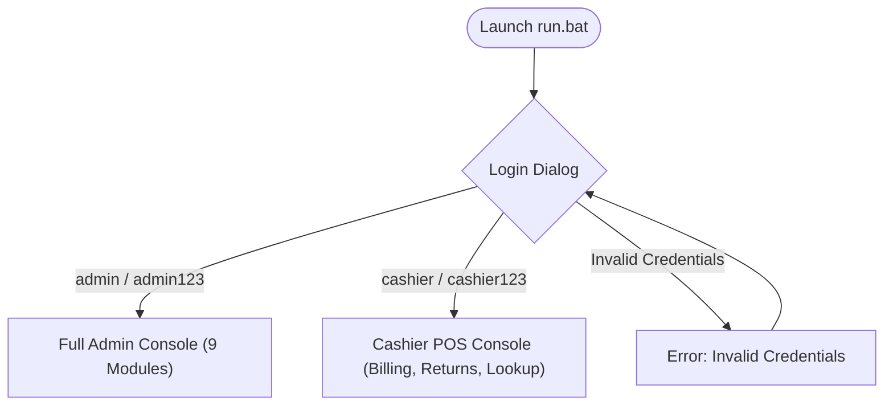

# ShelfLife System User Manual (`USER_MANUAL.md`)

## 1. Introduction

Welcome to **ShelfLife — Inventory, Expiry & Billing Management System**. ShelfLife is a high-reliability desktop application engineered for supermarkets, grocery stores, and pharmacies. It provides real-time expiry alerts, automated First-Expiry-First-Out (FEFO) stock allocation, point-of-sale customer billing, returns with refund calculation, vendor management, and financial analytics.

---

## 2. System Roles & Access Matrix

ShelfLife provides two operational roles out of the box:

| Application Module | Administrator (`ADMIN`) | Cashier (`CASHIER`) |
| :--- | :---: | :---: |
| **Product & Inventory Management** | Full CRUD, Toggle Active | Lookup / Read Only |
| **Stock Intake & Suppliers** | Full Access | No Access |
| **Expiry Alerts & Wastage** | Full Access | No Access |
| **Point-of-Sale (POS) Billing** | Full Access | Full Access |
| **Customer Returns & Refunds** | Full Access | Full Access |
| **Reports & KPI Dashboard** | Full Access | No Access |
| **Stock Reorder Planning** | Full Access | No Access |
| **Activity Audit Trail** | Full Access | No Access |
| **System Settings & Backups** | Full Access | No Access |

---

## 3. Getting Started

### 3.1 Initial Launch & Authentication
1. Execute `run.bat` in the project root directory.
2. The **Authentication Modal** will appear:
   - **Default Admin Account**:
     - Username: `admin`
     - Password: `admin123`
   - **Default Cashier Account**:
     - Username: `cashier`
     - Password: `cashier123`
3. Click **Sign In**. The desktop window will render the interface appropriate for your assigned role.

---

## 4. Cashier Operations Guide

### 4.1 Processing a Customer Sale (POS Billing)
1. Navigate to **Billing & Sales POS** from the sidebar.
2. **Adding Products to Cart**:
   - **Barcode / SKU Scanner**: Type or scan an item's barcode or SKU into the quick-scan box and press **Enter**.
   - **Dropdown Selection**: Select a product from the dropdown list, specify the desired quantity, and click **Add to Cart**.
3. **Review Cart**:
   - The table displays Product ID, Name, Quantity, Unit Price, and Line Total.
   - You can highlight any item and click **Remove Item** or **Clear Cart** at any time prior to payment.
4. **Checkout & Payment**:
   - Select the customer's payment method:
     - **Cash**
     - **Debit / Credit Card**
     - **Easypaisa**
     - **JazzCash**
   - Click **Complete Sale**.
5. **Customer Receipt**:
   - A branded receipt modal pops up displaying the itemized breakdown, tax amount, and PKR grand total.
   - An exact copy is automatically saved as a `.txt` receipt in the `receipts/` directory.

### 4.2 Handling Customer Returns & Refunds
1. Click **Returns & Refunds** in the sidebar.
2. Enter the original **Sale ID** (e.g., `SALE-20261027-142010-1234`) and click **Lookup Transaction**.
3. The table loads all sold line items, original prices, and prior return counts.
4. Set the **Return Qty** for the returned items.
5. Select the **Disposition**:
   - **RESTOCK**: Choose this if the item is undamaged, unopened, and unexpired. The item is safely returned to sellable inventory.
   - **WASTAGE**: Choose this if the item was returned broken, spoiled, or leaking. The refund is issued, but the item is permanently written off to wastage.
6. Enter a mandatory reason (e.g. `"Customer overbought"` or `"Defective packaging"`) and click **Process Return & Refund**.
7. The system computes the refund in PKR, updates inventory, and issues a return transaction ID.

---

## 5. Administrator Operations Guide

### 5.1 Managing Products
- Navigate to **Inventory & Batches**.
- Click **Add Product** to create a new product with category, selling price, low-stock threshold, barcode, and SKU.
- **Deactivating Products**: If a product is discontinued, select it and click **Deactivate / Soft-Delete**. Deactivated products remain in historical records but cannot be sold at checkout.

### 5.2 Stock Intake & Supplier Receiving
- Navigate to **Stock Intake & Suppliers**.
- Register vendors with contact numbers and email addresses.
- To receive new inventory shipments:
  1. Select the supplier.
  2. Select the product.
  3. Enter the batch number, quantity received, purchase cost price (PKR), and expiry date.
  4. Click **Receive Stock into Inventory**. The batch is immediately created and available for FEFO sale.

### 5.3 Expiry Tracking & Wastage Write-Off
- Navigate to **Expiry Alerts & Wastage**.
- View color-coded alerts:
  - Red: Expired batches (blocked from sale).
  - Orange: Near-expiry batches (expiring within warning threshold).
  - Green: Healthy stock.
- To discard unsellable expired goods, select the batch, enter the quantity, select a reason (e.g. `"Expired"`, `"Damaged"`), and click **Record Stock Wastage**.

### 5.4 Reorder Planning
- Navigate to **Stock Reorder List**.
- View all active products whose total stock has fallen below their minimum threshold.
- The screen displays current stock, reorder point, suggested reorder quantity, and linked supplier contacts.
- Click **Export Reorder Report (CSV)** to generate purchase orders.

### 5.5 Operational Reports & KPI Dashboard
- Navigate to **Reports & Dashboard**.
- Review the 7 top-level KPI cards:
  - Total Active Products
  - Total Sellable Stock Units
  - Low Stock Products Count
  - Expired Batches Count
  - Today's Revenue (PKR)
  - Total Wastage Losses (PKR)
  - **Net Operating Profit (PKR)**
- Switch between tabs: **Sales History**, **Stock Information**, **Wastage Records**, and **Returns & Refunds History**.
- Click **Export Report Data (CSV)** on any tab to save data for external accounting.

### 5.6 System Settings, User Provisioning & Backups
- Navigate to **Settings & Backup**.
- **Configure Store**: Adjust shop name, currency symbol (`Rs.`), currency code (`PKR`), expiry warning days, and tax percentage.
- **Create Users**: Register new Cashier or Administrator accounts with salted passwords.
- **Backups**:
  - Click **Create Backup Archive** to generate a timestamped snapshot of all 11 CSV files.
  - To restore, click **Restore from Backup Archive**, choose the desired backup folder, and confirm. A safety pre-restore backup is automatically created before overwriting.

---

## 6. Troubleshooting & FAQ

**Q: Where are the application database files stored?**  
**A:** By default, ShelfLife stores all data in your Windows User Profile:  
`C:\Users\<YourUsername>\ShelfLifeData\`  
This ensures persistent data across reboots and NetBeans rebuilds.

**Q: What if a power failure occurs during checkout?**  
**A:** ShelfLife features a multi-file transaction engine. Before modifying files, synchronous `.bak` snapshots are created. If interrupted, the system rolls back to the clean pre-sale state automatically.

**Q: Can a product with historical sales be deleted?**  
**A:** Hard deletion is blocked to protect historical audit trails and receipts. Use the **Deactivate** button to soft-delete the product instead.
